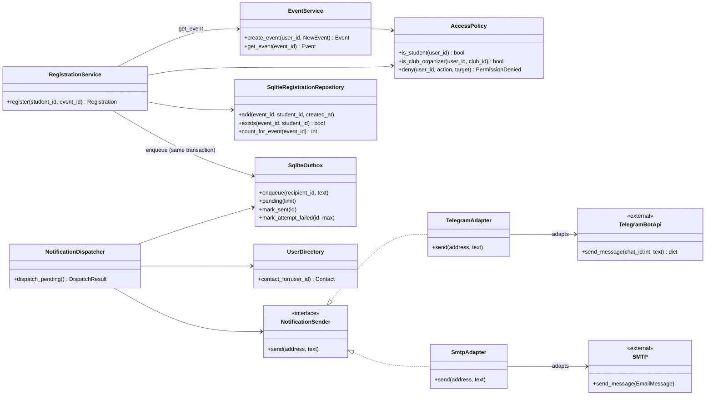

# Class diagram: "create and register for an event"

`app/main.py` (composition root) creates all objects and decides which adapters the dispatcher receives.
Tests replace the adapters with `FakeNotificationSender`.
