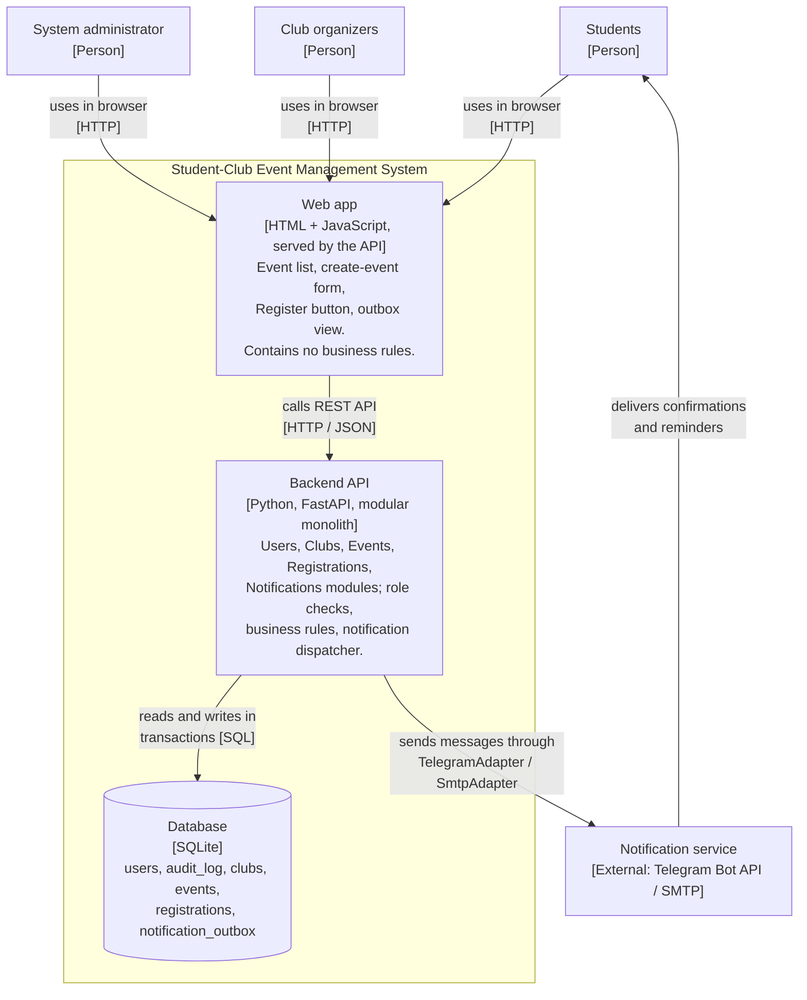

# Container Diagram (C4 level 2), updated in Milestone 3

**Legend.** Boxes inside the frame are containers of our system. Boxes outside are people and the external system.

## Changes from Milestone 2

| What changed | Why |
|---|---|
| Technology is now named: FastAPI (Python) for the Backend API, SQLite for the Database. | Chosen for the prototype; one file database needs no server, so every member can run the project. The relational design is unchanged, so moving to PostgreSQL later only changes the repositories. |
| The Web app is a static page served by the Backend API, not a separate single-page app project. | One deployable unit is enough for the prototype. It is still a separate container at run time (runs in the browser). |
| The dispatcher is triggered by an API call (`POST /api/notifications/dispatch`) instead of a timer. | See the update in ADR-001. |
