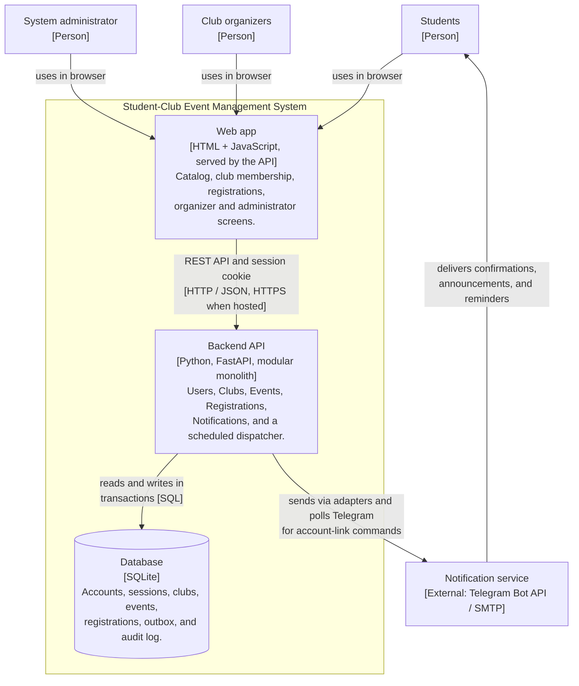

# Container Diagram (C4 level 2)

**Legend.** Boxes inside the frame are containers of our system. Boxes outside are people and the external system.

## Implementation notes

- FastAPI serves the web app as static assets. The browser displays state and submits actions. The API enforces
  role, ownership, registration, and capacity rules.
- SQLite uses a connection per worker thread and explicit write transactions for operations that need to be atomic.
- The API runs the notification dispatcher on a schedule in normal mode. Demo mode uses a manual dispatcher and
  console transport adapters so the queue is visible during the presentation. See [ADR-001](../adr/ADR-001-notification-outbox.md).
